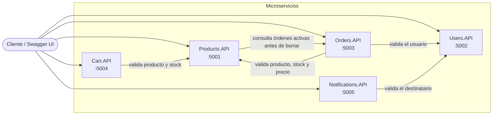

# TP Microservicios E-Commerce · Grupo 9

Trabajo práctico de **Arquitectura y Diseño de Software**. Un sistema de E-Commerce armado con
5 microservicios independientes, cada uno una REST API en C# con .NET 10 y su propia base de datos.

## Integrantes y responsables

| Integrante | Servicios |
|---|---|
| Agus | Products, Cart |
| Pili | Users, Notifications |
| Rama | Orders |

Los aspectos transversales (errores, logging, Correlation ID, Swagger y health checks) se
construyeron como bloques reutilizables y los incorpora cada servicio.

## Tecnologías

| Propósito | Tecnología |
|---|---|
| Framework | .NET 10 / ASP.NET Core |
| Documentación de la API | Swashbuckle.AspNetCore 6.6.2 (Swagger UI) |
| Logging | Serilog: consola legible y archivo JSON |
| Persistencia | SQLite con Dapper (ver la nota de persistencia más abajo) |
| Validación | Data Annotations |
| Manejo de errores | `IExceptionHandler` con `ProblemDetails` |
| HTTP entre servicios | `IHttpClientFactory` |

## Estructura del repositorio

```
ECommerce.slnx
├── src/
│   ├── Products.API/
│   ├── Users.API/
│   ├── Orders.API/
│   ├── Cart.API/
│   └── Notifications.API/
└── docs/
```

Cada servicio sigue la misma estructura, con Products como plantilla:

```
<Servicio>.API/
├── Controllers/         Reciben el pedido HTTP y devuelven el status
├── Models/              Entidades del dominio
├── DTOs/                Request y response de cada endpoint
├── Services/            Lógica de negocio y clientes HTTP hacia otros servicios
├── Data/                Repositorios con SQLite y Dapper, detrás de una interfaz
├── Exceptions/          ErrorCodes y excepciones de dominio
├── ExceptionHandlers/   Un IExceptionHandler por tipo de excepción
├── Extensions/          Bloques transversales (logging, Correlation ID, errores, Swagger)
├── logs/                Archivos de log de Serilog (no se versionan)
└── Program.cs           Solo compone los bloques
```

## Servicios y puertos

| Servicio | Puerto | Responsabilidad | Base de datos | Swagger |
|---|---|---|---|---|
| Products.API | 5001 | Catálogo de productos | `products.db` | http://localhost:5001/swagger |
| Users.API | 5002 | Registro y login de usuarios, con bloqueo de cuenta | `users.db` | http://localhost:5002/swagger |
| Orders.API | 5003 | Órdenes de compra y sus estados | `orders.db` | http://localhost:5003/swagger |
| Cart.API | 5004 | Carrito de compras por usuario | `cart.db` | http://localhost:5004/swagger |
| Notifications.API | 5005 | Registro y simulación de notificaciones | `notifications.db` | http://localhost:5005/swagger |

Los puertos y las URLs entre servicios están en el `appsettings.json` de cada uno (secciones
`Urls` y `Services`) y no se escriben en el código.

## Arquitectura

Cada servicio es independiente y tiene su propia base de datos. Se comunican solo por HTTP,
usando las URLs de la sección `Services` de su `appsettings.json`.



<details>
<summary>Versión en texto del diagrama</summary>

```
 Cliente / Swagger UI
    |
    +--> Products.API :5001 ----(órdenes activas, antes de borrar)----> Orders.API
    |
    +--> Users.API :5002           (no llama a ningún servicio)
    |
    +--> Orders.API :5003 ------(valida el usuario)-------------------> Users.API
    |                     +-----(valida producto, stock y precio)-----> Products.API
    |
    +--> Cart.API :5004 --------(valida producto y stock)-------------> Products.API
    |
    +--> Notifications.API :5005 --(valida el destinatario)-----------> Users.API
```

</details>

### Llamadas entre servicios

| Servicio | Llama a | Para qué | Si falla |
|---|---|---|---|
| Cart.API | Products.API | Validar producto y stock (CRT-002, CRT-003) | 500 con CRT-005 |
| Orders.API | Users.API | Validar que el usuario exista (ORD-003) | 500 con ORD-007 |
| Orders.API | Products.API | Validar producto, stock y precio (ORD-004, ORD-005) | 500 con ORD-007 |
| Notifications.API | Users.API | Validar al destinatario (NTF-001) | 500 con NTF-004 |
| Products.API | Orders.API | Verificar órdenes activas antes de borrar (PRD-004) | 500 con PRD-005 |
| Users.API | Ninguno | No depende de otros servicios | No aplica |

Reglas que siguen todas las llamadas:

- **Un 404 del servicio remoto es el error de negocio del servicio que llama.** Por ejemplo, si
  Users responde 404 para un usuario, Orders devuelve ORD-003 y Notifications devuelve NTF-001.
- **Cualquier otro fallo** (timeout, servicio caído, 5xx) es un 500 con el código interno del
  servicio que llama, y la operación no se completa.
- **El status HTTP se verifica siempre antes de procesar la respuesta.**
- **El Correlation ID viaja